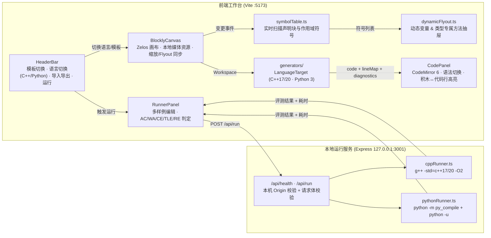

# AlgoBlocks 系统架构文档 (ARCHITECTURE)

## 一、总体架构

AlgoBlocks 采用前后端分离的本地桌面级 Web IDE 架构：前端基于 **React 19 + TypeScript + Tailwind CSS v4 + Google Blockly (Zelos) + CodeMirror 6**，后端基于 **Node.js + Express + TypeScript (`tsx`)** 调用本机 `g++` 与 `python` 执行真实编译与运行评测。

---

## 二、核心子系统说明

### 1. 强类型符号表与动态抽屉 (`symbolTable.ts` + `dynamicFlyout.ts`)
- 监听 Blockly 工作区变更（创建、删除、移动、字段修改、加载完成），即时提取所有声明积木（标量、常量、一维/二维数组、STL 容器、循环变量、自定义函数）构建 `SymbolTable`。
- **「我的变量」抽屉 (`ALGO_VARIABLES`)**：按去重后的符号表动态生成对应变量的取值块、赋值块以及自定义函数调用块。
- **「类型方法与算法」抽屉 (`ALGO_METHODS`)**：依据已声明变量的具体类型（`string`、`vector`、`deque`、`stack`、`queue`、`priority_queue`、`set`、`map`、`pair`、数组）自动解锁并预填变量名的专属方法积木，同时始终保留通用 `<algorithm>` 积木。

### 2. 多语言实时代码生成 (`generators/`)
- 通过 `LanguageTarget` 抽象接口解耦前端界面与具体目标语言：
  - **C++17/20 (`generators/cpp/index.ts`)**：支持 `#include <bits/stdc++.h>` 与按需最小头文件切换、快读开关、全局区与自定义函数前置排放。
  - **Python 3 (`generators/python/index.ts`)**：将同一份积木工程实时翻译为可直接运行的 Python 3 代码，自动按需注入 `sys.stdin` 分词读取器（`cin` 对应）、`heapq`（优先队列对应）、`collections.deque` / `defaultdict` 等标准库映射，并保持整型除法语义一致。
- 两个生成器均在拼装代码行时记录每个积木的起止行号（`lineMap: Record<blockId, [startLine, endLine]>`），与 `CodePanel` 的 CodeMirror 6 `Decoration.line` 联动，实现点击积木即滚动并高亮对应代码。

### 3. Blockly 布局与缩放同步机制 (`BlocklyCanvas.tsx`)
- **缩放保持积木页打开**：在工作区实例上拦截 `setScale` 期间的 `hideChaff`，将 `onlyClosePopups` 透传为 `true`（仅关闭下拉/提示气泡，不触发工具箱 `autoHide`），并在缩放完成后立即执行 `flyout.reflow()` 与 `flyout.position()`。
- **SVG 属性兼容性**：在 `index.css` 中添加 `svg[display="none"] { display: none !important; }`，防止 Tailwind v4 preflight 覆盖 Blockly 滚动条的 SVG `display="none"` 属性。
- **视口自适应**：通过 `ResizeObserver`、`window.resize` 与 `window.visualViewport.resize` 三路监听并在 `requestAnimationFrame` 中执行 `safeResizeWorkspace()`。

### 4. 代码转积木 (`parsers/`)
- 基于已内置的 `@lezer/cpp` 与 `@lezer/python` 纯前端同步 LR 解析器（零 WASM 体积、离线可用），将 C++ / Python 代码解析为抽象语法树并映射为 Blockly JSON。
- 未覆盖的冷门语法自动降级包装为 `algo_raw_code`（语句）或 `algo_raw_expr`（表达式）兜底积木，保证“永不崩溃、转换后仍可生成可运行代码”。

### 5. 双模式运行（本地服务 + GitHub Pages 静态免后端）
- **本地优先模式** (`server/`，监听 `127.0.0.1:3001`)：检测到本地 `/api/health` 可用时，调用本机 `g++ -std=c++17|c++20 -O2` 与 `python -u` 执行，支持隔离临时目录、超时强杀（TLE）与 256 KiB 输出截断。
- **纯静态网页模式** (`browserRunners.ts`，适配 GitHub Pages)：当本地后端不可达时自动无缝切换：
  - **Python 3**：在独立 Web Worker 中按需加载 **Pyodide WebAssembly**，完全在浏览器端运行，超时时直接 `worker.terminate()` 强制终止死循环。
  - **C++17/20**：自动请求 **Wandbox** 公开 GCC 编译接口，支持 `stdin` 与 AC/WA/CE/TLE 判定。
- **静态构建与发布**：`vite.config.ts` 使用相对 `base: './'`，Blockly 媒体资源路径使用 `${import.meta.env.BASE_URL}blockly-media/`，并配套 `.github/workflows/deploy-pages.yml` 自动部署至 GitHub Pages。
